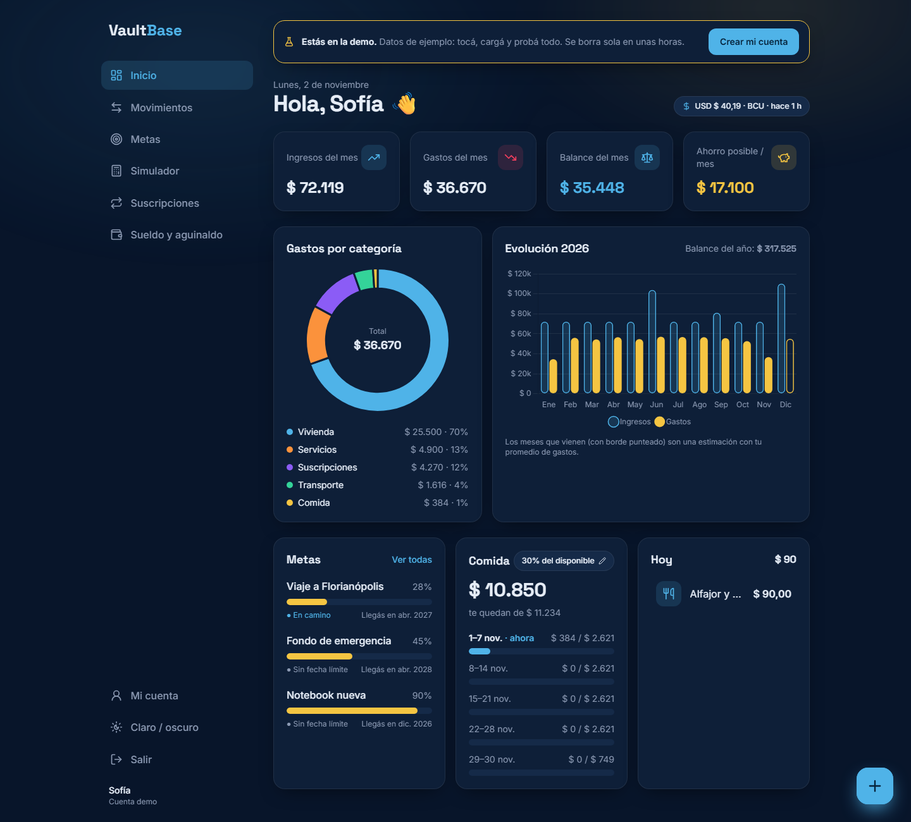
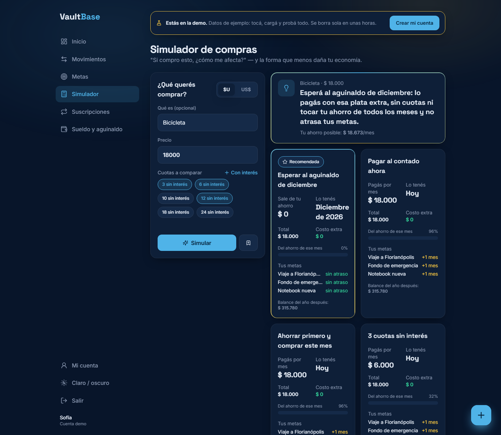
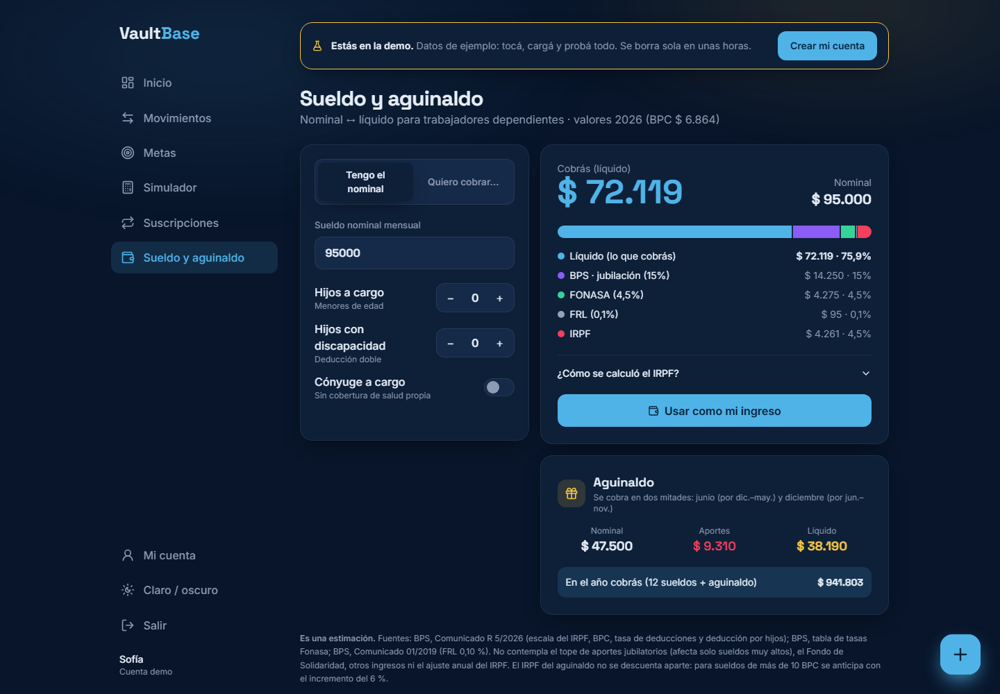
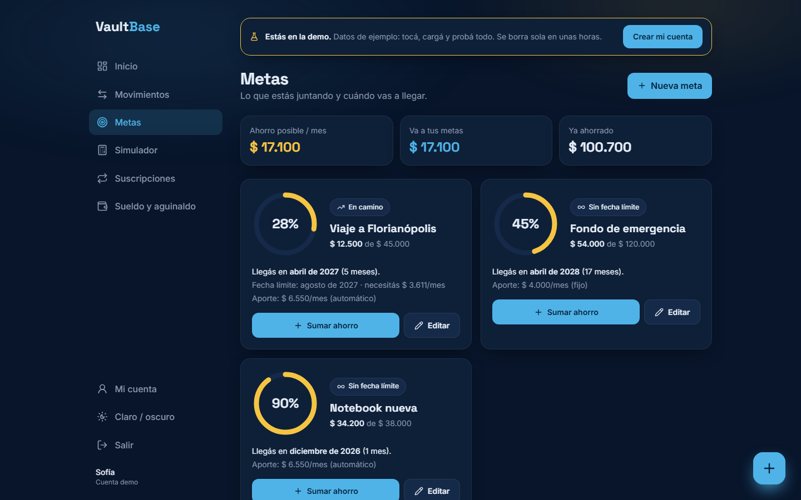
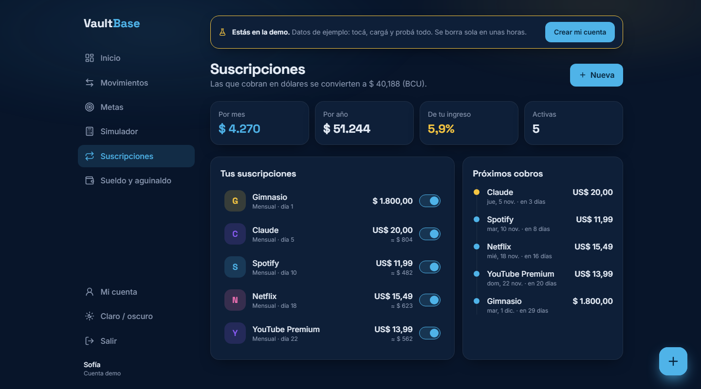
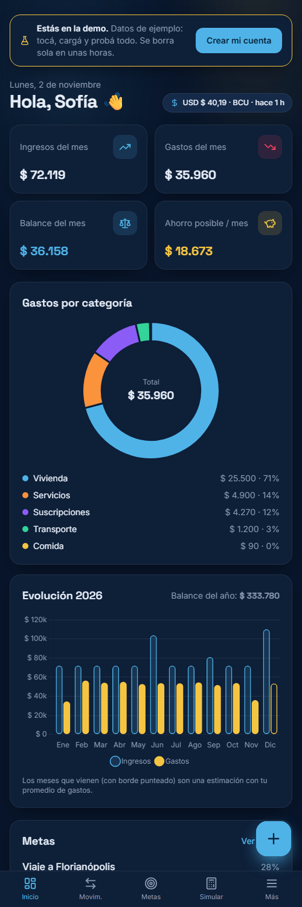
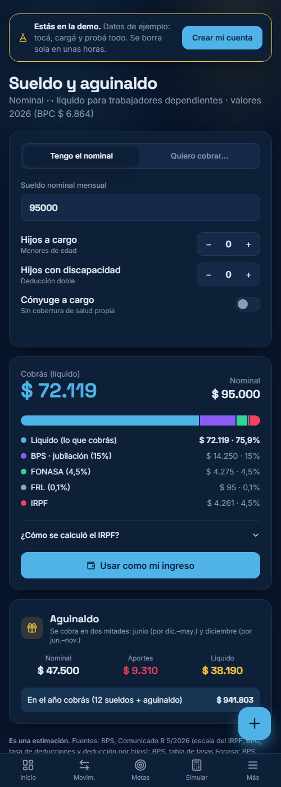

<div align="center">

# VaultBase

**Finanzas personales hechas para Uruguay.**
Anotá un gasto en 3 toques, mirá a dónde se va tu sueldo y simulá una compra *antes* de hacerla:
VaultBase te dice la forma que menos daña tu economía.

`Python` · `FastAPI` · `SQLModel` · `PostgreSQL` · `Alembic` · `JWT` · `JavaScript` · `Tailwind CSS` · `Chart.js` · `pytest`

**[▶ Probar la demo](#-demo)** · [Funcionalidades](#-funcionalidades) · [Arquitectura](#-arquitectura) · [Correrlo en tu PC](#-correrlo-en-tu-pc) · [Deploy](#-deploy)



</div>

## ▶ Demo

En la página de inicio, **"Probar la demo"** crea al instante una cuenta con 10 meses de datos de
ejemplo (sueldo, gastos del día a día, suscripciones en dólares, metas…), sin registrarse.
Cada visitante recibe su propia copia y se borra sola a las 6 horas.

> La versión gratuita de Render "duerme" el servidor tras 15 minutos sin visitas: la primera carga puede tardar ~50 segundos.

## ✨ Funcionalidades

| | |
|---|---|
| **⚡ Gasto rápido** | Botón flotante siempre a mano: monto, categoría, subcategoría y listo. 14 categorías con subcategorías (súper, feria, delivery, kiosco…). |
| **📊 Dashboard** | Balance del mes y del año, gastos por categoría, evolución mensual con meses futuros proyectados, números animados. |
| **🎯 Metas** | Progreso, fecha estimada de llegada según tu ahorro real, aviso si vas atrasado para la fecha límite y celebración al cumplirla. |
| **🧮 Simulador de compras** | Compara contado, ahorrar primero, esperar al aguinaldo y cuotas (con o sin interés, sistema francés). Muestra el impacto en el mes, el año y **cuántos meses se atrasa cada meta**, y recomienda la opción de menor daño. |
| **💼 Sueldo nominal ↔ líquido** | Calculadora para dependientes con valores oficiales del BPS 2026: aportes jubilatorios, FONASA según familia, FRL e IRPF por franjas con deducciones. Funciona en ambas direcciones y estima el aguinaldo. |
| **🔁 Suscripciones** | Spotify, Netflix, Claude… total mensual y anual, % del ingreso y línea de tiempo de próximos cobros. |
| **💵 Dólar automático** | Cotización oficial del **BCU** (servicio SOAP) con respaldo en una API pública y caché. Cada gasto en USD congela la cotización de su fecha. |
| **🍽️ Presupuesto de comida** | % configurable del ingreso disponible, dividido por semanas. |

<table>
  <tr>
    <td></td>
    <td></td>
  </tr>
  <tr>
    <td></td>
    <td></td>
  </tr>
</table>

<p align="center">
  
  &nbsp;&nbsp;
  
</p>

## 🏗 Arquitectura

```
vaultbase/
├─ backend/
│  ├─ app/
│  │  ├─ main.py          # FastAPI: rutas, middleware de seguridad, sirve el frontend
│  │  ├─ models/          # tablas SQLModel + esquemas de entrada/salida (Create/Read/Update)
│  │  ├─ routers/         # endpoints: auth, CRUD genérico, finanzas, sueldo, categorías
│  │  ├─ services/        # lógica pura y testeable: finanzas, simulador, sueldo, cotización, demo
│  │  ├─ security.py      # hash Argon2 + JWT
│  │  └─ categories.py    # árbol de categorías (única fuente de verdad para back y front)
│  ├─ migrations/         # Alembic
│  └─ tests/              # 80 tests con pytest (sin internet: las fuentes de cotización se simulan)
├─ frontend/              # HTML + módulos ES + Tailwind + Chart.js, sin frameworks
├─ scripts/build_frontend.py  # compila Tailwind para producción
├─ build.sh · render.yaml     # deploy en Render
└─ docs/screenshots/
```

**Decisiones de diseño destacadas**

- **Dinero en centésimos enteros.** Nunca `float` para plata: `$ 1.500,50` se guarda como `150050`.
- **Lógica de negocio pura.** Los cálculos (`services/finance.py`, `simulator.py`, `salary.py`) no tocan la base ni internet: reciben datos y devuelven resultados, por eso se testean en milisegundos con casos calculados a mano.
- **El simulador modela calendarios de pago.** Cada estrategia es una lista de pagos mes a mes; un motor común los descuenta del ahorro libre y de las metas, y compara contra no comprar para medir el atraso.
- **Seguridad.** Contraseñas con Argon2, JWT firmado, toda consulta filtrada por el dueño (un usuario recibe 404 si pide datos de otro), mensajes de login que no revelan qué emails existen, escape de HTML contra XSS, protección contra *open redirect*, encabezados `nosniff` / `X-Frame-Options`, y la app se niega a arrancar en producción sin una `SECRET_KEY` propia.
- **CRUD genérico.** Una fábrica de routers genera los 5 endpoints para cada recurso (DRY), con ganchos para validaciones entre campos.
- **Sin framework de frontend.** Páginas HTML con módulos ES, un *shell* común, tokens de diseño en CSS (modo claro/oscuro), *View Transitions* entre páginas y animaciones que respetan `prefers-reduced-motion`.

**API documentada:** FastAPI genera Swagger en `/docs`.

## 💻 Correrlo en tu PC

Requisitos: Python 3.13+.

```bash
git clone https://github.com/F71Tech/vaultbase.git
cd vaultbase
python -m venv .venv
.venv\Scripts\python -m pip install -r requirements.txt   # en macOS/Linux: .venv/bin/python
copy .env.example .env                                     # y poné una SECRET_KEY propia
.venv\Scripts\python -m uvicorn backend.app.main:app --reload
```

Abrí http://localhost:8000 (la base SQLite y sus tablas se crean solas con las migraciones).

```bash
.venv\Scripts\python -m pytest            # correr los tests
.venv\Scripts\alembic revision --autogenerate -m "describí el cambio"   # nueva migración
```

## 🚀 Deploy

Gratis con **Render** (app) + **Neon** (PostgreSQL que no vence):

1. En [Neon](https://neon.tech) creá un proyecto y copiá la *connection string* (`postgresql://…`).
2. En [Render](https://render.com): **New → Blueprint**, elegí este repositorio (lee `render.yaml`).
3. Cuando pida `DATABASE_URL`, pegá la de Neon. `SECRET_KEY` la genera Render.
4. Listo: el build compila Tailwind, al arrancar se aplican las migraciones y cada `git push` a `main` publica una versión nueva.

## ⚠️ Alcance

La calculadora de sueldo es una **estimación** (no contempla el tope de aportes jubilatorios, el Fondo de Solidaridad ni el ajuste anual del IRPF). Fuentes: BPS, Comunicado R 5/2026; tabla de tasas Fonasa; Comunicado 01/2019 (FRL).

---

<div align="center">Hecho por <a href="https://github.com/F71Tech">F71Tech</a> · proyecto de portfolio</div>
